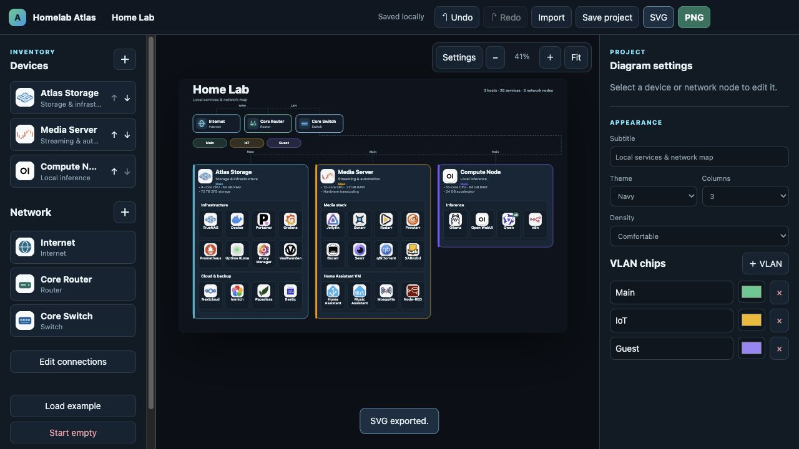

<div align="center">
  

# Homelab Atlas

**Your homelab, clearly mapped.**

A local-first visual editor for polished, portable homelab diagrams.

[](https://github.com/aiden0rchad/homelab-atlas/actions/workflows/ci.yml)
[](https://aiden0rchad.github.io/homelab-atlas/)
[](https://github.com/aiden0rchad/homelab-atlas/releases/latest)
[](https://github.com/users/aiden0rchad/packages/container/package/homelab-atlas)
[](LICENSE)

[Documentation](https://aiden0rchad.github.io/homelab-atlas/) · [Install](https://aiden0rchad.github.io/homelab-atlas/getting-started) · [Releases](https://github.com/aiden0rchad/homelab-atlas/releases) · [Package](https://github.com/users/aiden0rchad/packages/container/package/homelab-atlas) · [GitHub](https://github.com/aiden0rchad/homelab-atlas)
</div>



## What it does

- Builds automatic diagrams from devices, hardware facts, service groups, network nodes, VLAN chips, and logical connections.
- Bundles a searchable offline logo catalog with multi-select and custom service names.
- Offers navy, light, and midnight themes; 1–4 columns; comfortable or compact density.
- Autosaves in the current browser and exports portable JSON, SVG, or PNG.
- Runs without accounts, telemetry, AI calls, network scanning, a database, or Docker socket access.

## Quick start

Install Docker Engine or Docker Desktop with Compose v2, then download the release Compose file and start the published image:

```sh
curl -fsSLO https://github.com/aiden0rchad/homelab-atlas/releases/download/v0.1.0/compose.release.yaml
docker compose -f compose.release.yaml up -d
```

Open `http://localhost:8080`. The container binds to loopback by default. See [installation options and version pinning](https://aiden0rchad.github.io/homelab-atlas/getting-started).

## From inventory to export

1. Choose **Load example** or **Start empty**.
2. Add device templates, then edit names, hardware, icons, groups, and services.
3. Add network nodes, VLAN chips, and named logical relationships.
4. Tune the title, subtitle, theme, columns, density, and preview fit.
5. Use **Save project** for an editable JSON backup, or export SVG/PNG to share.

## Documentation

| Guide | Covers |
|---|---|
| [Getting started](https://aiden0rchad.github.io/homelab-atlas/getting-started) | Install, run, update, and trusted-LAN access |
| [Editor guide](https://aiden0rchad.github.io/homelab-atlas/editor) | Devices, services, appearance, layout, and shortcuts |
| [Networking](https://aiden0rchad.github.io/homelab-atlas/networking) | Network nodes, VLAN labels, and logical connections |
| [Sharing and backup](https://aiden0rchad.github.io/homelab-atlas/sharing) | Browser storage, conflicts, JSON, SVG, and PNG |
| [Privacy](https://aiden0rchad.github.io/homelab-atlas/privacy) | Data boundaries and safe deployment |
| [Troubleshooting](https://aiden0rchad.github.io/homelab-atlas/troubleshooting) | Storage, imports, startup, layout, and export issues |
| [Project format](https://aiden0rchad.github.io/homelab-atlas/project-format) | Schema version 1 and validation limits |
| [Releases](https://aiden0rchad.github.io/homelab-atlas/releases/) | Images, downloads, checksums, and version tags |
| [Development](https://aiden0rchad.github.io/homelab-atlas/development) | Source layout, checks, docs, and logo maintenance |

## Storage, privacy, and limits

Projects stay in browser storage for the current browser profile and origin. Clearing storage, using private browsing, or changing the hostname or port can make a project appear missing. Save JSON before updates or origin changes.

Homelab Atlas has no authentication. Keep it on loopback or a trusted LAN; do not expose it directly to the public internet. Diagrams use automatic layout rather than drag-to-position. Connections describe logical relationships, not exact physical switch ports. There is no discovery or live monitoring.

Image exports contain exactly what you entered—there is no automatic redaction. Review names, labels, addresses, and screenshots before sharing. JSON is the editable backup format; image exports are not.

## Contributing and support

See [CONTRIBUTING.md](CONTRIBUTING.md) for focused checks and [SECURITY.md](SECURITY.md) for private vulnerability reporting. If the project is useful, you can [buy me a coffee](https://www.buymeacoffee.com/aiden0rchad).

## License

Original code is [MIT licensed](LICENSE). Bundled logos retain their upstream licenses; product names and trademarks belong to their owners. See [THIRD_PARTY_NOTICES.md](THIRD_PARTY_NOTICES.md).
