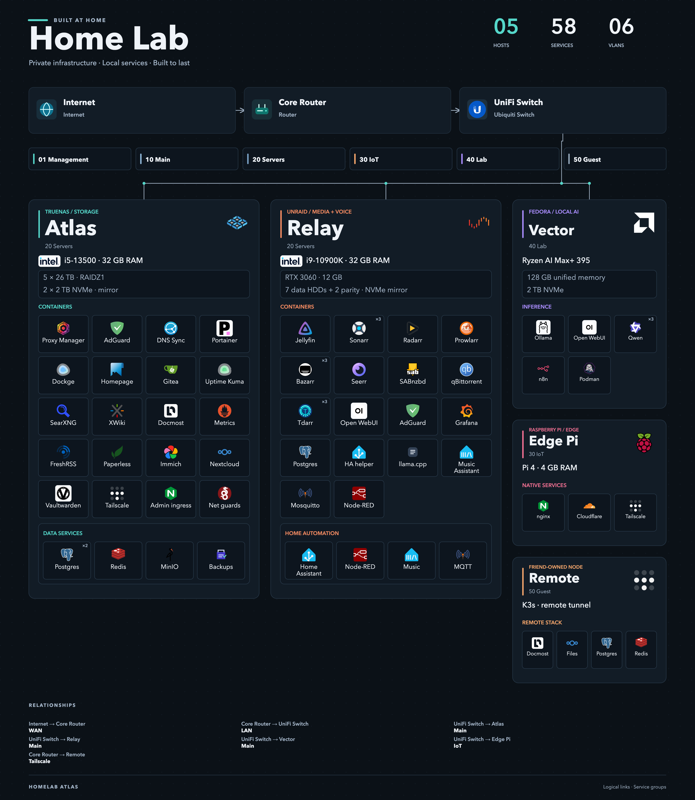

## See the editor

Edit the inventory and settings beside a responsive preview. The bundled sample is fictional and safe to explore.

## See the result

The same automatic layout powers the live preview, SVG export, and PNG export.

## Start, shape, save, share

  
<strong>1 · Start</strong>Load the example or begin empty.

  
<strong>2 · Inventory</strong>Add devices, hardware, and services.

  
<strong>3 · Connect</strong>Add networks, VLANs, and relationships.

  
<strong>4 · Refine</strong>Choose theme, columns, and density.

  
<strong>5 · Save</strong>Back up JSON; export SVG or PNG.

Projects contain only what you enter. Start with [installation and safe deployment](/getting-started), then follow the [editor guide](/editor).

If Homelab Atlas is useful, you can <a href="https://www.buymeacoffee.com/aiden0rchad" target="_blank" rel="noopener noreferrer">buy me a coffee</a> to support its continued development.

